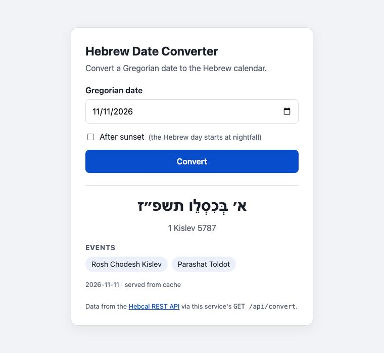

# Hebrew Date Converter

A small service and web page that converts **between Gregorian and Hebrew dates** (both
directions), built as an
integration with the [Hebcal Hebrew Date Converter REST API](https://www.hebcal.com/home/219/hebrew-date-converter-rest-api).

The browser never calls Hebcal directly. It calls this service's own API, which validates the
input, calls Hebcal with a timeout and retry, validates Hebcal's answer, maps it to a clean
response format, and caches the result.

Selecting a date also shows its **Gregorian month as a calendar with the Hebrew date in every
day**, built from a single Hebcal _range_ request per month.



## Quick start

Requires Node.js 20+ (developed on Node 26).

```bash
npm install
npm run dev          # http://localhost:3000
```

Other scripts:

| Command             | What it does                                     |
| ------------------- | ------------------------------------------------ |
| `npm test`          | Unit + route tests (no network, Hebcal is faked) |
| `npm run lint`      | ESLint                                           |
| `npm run typecheck` | TypeScript type check                            |
| `npm run build`     | Compile to `dist/`                               |
| `npm start`         | Run the compiled server                          |

Logs are JSON lines. For readable logs in development: `npm run dev | npx pino-pretty`.

## Architecture

```
Browser (public/)            This service (src/)                                   Hebcal
─────────────────            ──────────────────────────────────────────────────    ──────────
index.html + app.js  ──GET /api/convert?date=───▶  routes/convert.ts
                     ──GET /api/convert-hebrew?─▶  routes/convert.ts
                     ──GET /api/calendar?month=─▶  routes/calendar.ts
                                                     │ validation/dateQuery.ts  (400 if invalid)
                                                     ▼
                                                  services/converterService.ts ──▶ lib/cache.ts
                                                     │ (cache miss)                (dates, months)
                                                     ▼
                                                  services/hebcalClient.ts  ──HTTPS──▶ /converter
                                                     │ convert():      ?gy&gm&gd&g2h=1  (one date)
                                                     │ convertFromHebrew(): ?hy&hm&hd&h2g=1
                                                     │ convertMonth(): ?start&end       (range)
                                                     │ timeout, retry, schema check, map to DTO
                                                     ▼
                     ◀── JSON (DTO) or JSON error ── middleware/errorHandler.ts
```

| Layer            | File                                                                           | Responsibility                                                                                    |
| ---------------- | ------------------------------------------------------------------------------ | ------------------------------------------------------------------------------------------------- |
| Composition root | `src/server.ts`                                                                | Reads config, wires real dependencies, starts the server, graceful shutdown                       |
| App              | `src/app.ts`                                                                   | Express app factory: request logging + request id, routes, static files, error handler            |
| Routes           | `src/routes/convert.ts`, `src/routes/calendar.ts`                              | HTTP only: parse query → call service → send JSON                                                 |
| Validation       | `src/validation/dateQuery.ts`, `src/lib/dates.ts`, `src/lib/hebrewCalendar.ts` | Strict `YYYY-MM-DD` / `YYYY-MM`, real calendar dates, `afterSunset`; Hebrew months and leap years |
| Service          | `src/services/converterService.ts`                                             | Business logic: cache lookup, call client, store result                                           |
| Integration      | `src/services/hebcalClient.ts`                                                 | Everything about Hebcal: URL, timeout, retry, status handling, response validation, mapping       |
| Errors           | `src/lib/errors.ts`, `src/middleware/errorHandler.ts`                          | Typed errors → one consistent JSON error shape                                                    |
| Config           | `src/config.ts`                                                                | Environment variables, validated at startup                                                       |

## API

### `GET /api/convert`

| Query param   | Required | Example      | Notes                                                                  |
| ------------- | -------- | ------------ | ---------------------------------------------------------------------- |
| `date`        | yes      | `2026-11-11` | Gregorian date, `YYYY-MM-DD`, years 0001–9999                          |
| `afterSunset` | no       | `true`       | The Hebrew day starts at nightfall; `true` returns the next Hebrew day |

```bash
curl "http://localhost:3000/api/convert?date=2026-11-11"
```

`200 OK`

```json
{
  "gregorian": { "date": "2026-11-11", "afterSunset": false },
  "hebrew": {
    "year": 5787,
    "month": "Kislev",
    "day": 1,
    "hebrewText": "א׳ בְּכִסְלֵו תשפ״ז",
    "parts": { "day": "א׳", "month": "כסלו", "year": "תשפ״ז" }
  },
  "events": ["Rosh Chodesh Kislev", "Parashat Toldot"],
  "source": "hebcal",
  "cached": false
}
```

### Errors

Every error has the same shape, with a stable `code` the client can switch on, and the
`requestId` that also appears in the logs and in the `X-Request-Id` response header.

```json
{
  "error": {
    "code": "INVALID_DATE",
    "message": "2025-02-30 is not a valid calendar date",
    "requestId": "..."
  }
}
```

| HTTP | `code`                  | When                                                                                 |
| ---- | ----------------------- | ------------------------------------------------------------------------------------ |
| 400  | `INVALID_DATE`          | Missing/malformed date, a date that doesn't exist, bad `afterSunset`                 |
| 502  | `UPSTREAM_UNAVAILABLE`  | Hebcal unreachable or returned 5xx (after retry)                                     |
| 502  | `UPSTREAM_BAD_RESPONSE` | Hebcal returned non-JSON, a 4xx, or a payload that doesn't match the expected schema |
| 504  | `UPSTREAM_TIMEOUT`      | Hebcal did not answer within `HEBCAL_TIMEOUT_MS`                                     |
| 404  | `NOT_FOUND`             | Unknown `/api` route                                                                 |
| 500  | `INTERNAL_ERROR`        | Unexpected bug (details logged, never sent to the client)                            |

### `GET /api/convert-hebrew`

The reverse direction: Hebrew date → Gregorian date (Hebcal `h2g=1`). Same response shape as
`/api/convert`.

| Query param | Required | Example  | Notes                                                                                  |
| ----------- | -------- | -------- | -------------------------------------------------------------------------------------- |
| `year`      | yes      | `5787`   | Hebrew year, 3762–9999 (earlier years fall before Gregorian year 1)                    |
| `month`     | yes      | `Kislev` | `Tishrei Cheshvan Kislev Tevet Shvat Adar Adar1 Adar2 Nisan Iyyar Sivan Tamuz Av Elul` |
| `day`       | yes      | `1`      | 1–30                                                                                   |

`Adar` is accepted only in regular years and `Adar1` / `Adar2` only in leap years. Whether a
month has 29 or 30 days in a given year is checked by Hebcal; its answer is returned as our `400`:

```bash
curl "http://localhost:3000/api/convert-hebrew?year=5787&month=Elul&day=30"
# 400 {"error":{"code":"INVALID_DATE","message":"Hebrew day 30 out of valid range 1-29 for Elul 5787",...}}
```

### `GET /api/calendar`

Every day of a Gregorian month with its Hebrew date and events, from **one** Hebcal range request
(`?start=2026-11-01&end=2026-11-30&g2h=1`) instead of ~30 single-date requests.

| Query param | Required | Example   | Notes                      |
| ----------- | -------- | --------- | -------------------------- |
| `month`     | yes      | `2026-11` | `YYYY-MM`, years 0001–9999 |

```bash
curl "http://localhost:3000/api/calendar?month=2026-11"
```

`200 OK` (shortened)

```json
{
  "month": "2026-11",
  "days": [
    {
      "date": "2026-11-11",
      "weekday": 3,
      "hebrew": {
        "year": 5787,
        "month": "Kislev",
        "day": 1,
        "hebrewText": "א׳ בְּכִסְלֵו תשפ״ז",
        "parts": { "day": "א׳", "month": "כסלו", "year": "תשפ״ז" }
      },
      "events": ["Rosh Chodesh Kislev", "Parashat Toldot"]
    }
  ],
  "source": "hebcal",
  "cached": false
}
```

`weekday` is 0 = Sunday … 6 = Saturday. Errors use the same shape and codes as `/api/convert`.

### `GET /api/health`

`{ "status": "ok", "uptimeSeconds": 42 }` — liveness check; does not call Hebcal.

## Configuration

All settings come from environment variables (see [`.env.example`](.env.example); copy it to `.env`
to override). They are validated at startup, so a wrong value stops the service immediately with a
clear message instead of failing later.

| Variable            | Default                            | Description                                       |
| ------------------- | ---------------------------------- | ------------------------------------------------- |
| `PORT`              | `3000`                             | HTTP port                                         |
| `HEBCAL_BASE_URL`   | `https://www.hebcal.com/converter` | Hebcal endpoint                                   |
| `HEBCAL_TIMEOUT_MS` | `5000`                             | Timeout per Hebcal request                        |
| `HEBCAL_RETRIES`    | `1`                                | Extra attempts on network errors / 5xx            |
| `CACHE_TTL_MS`      | `86400000` (24h)                   | How long a conversion is cached                   |
| `CACHE_MAX_ENTRIES` | `1000`                             | Cache size limit (least recently used is evicted) |
| `LOG_LEVEL`         | `info`                             | `fatal` … `trace`, or `silent`                    |

## Design decisions

- **A backend in front of Hebcal.** The page talks only to our API. That keeps the third party
  behind one integration point where we control validation, error handling, caching and logging,
  and lets us change provider without touching the client.
- **Our own response format (DTO).** Hebcal's fields (`hy`, `hm`, `hd`, `heDateParts`) are mapped
  to readable names in one place (`toHebrewPart` in `hebcalClient.ts`), shared by the single-date
  and range calls. Clients depend on our contract,
  not on Hebcal's.
- **Validate on the way in and on the way out.** Input is validated before any network call, so a
  bad date never costs a round trip. Hebcal's response is validated with a Zod schema, so an
  unexpected change in their payload becomes a clear `502 UPSTREAM_BAD_RESPONSE` instead of
  `undefined` showing up in the UI.
- **Timeouts and selective retry.** Each call has a hard timeout (`AbortController`) covering the
  whole exchange, including reading the body. Only transient failures (network error, 5xx) are
  retried, with a short backoff. Timeouts are not retried (we already waited the full budget), and
  4xx / bad payloads are not retried (asking again won't change the answer).
- **One range call per month.** The calendar needs ~30 conversions. Instead of 30 requests (slow,
  and unfriendly to a free public API) the client uses Hebcal's range mode once per month, and the
  page fetches a month only when the shown month changes.
- **Caching.** A date's Hebrew equivalent never changes; Hebcal itself returns
  `Cache-Control: max-age=31536000`. Two in-memory LRU caches with a TTL: single dates keyed by
  `date + afterSunset`, and months keyed by `YYYY-MM`. Errors are never cached.
- **Errors as types.** Each failure is a subclass of `AppError` with an HTTP status and code. One
  middleware converts them into the error JSON; unknown errors become a generic 500 and are logged
  with their stack.
- **Observability.** Structured JSON logs (pino) with a request id per request, accepted from
  `X-Request-Id` if the caller sends one, so a request can be traced across systems.
- **Dependency injection for testability.** `createApp` receives its service, and the Hebcal
  client receives `fetch`, so tests run the full stack with a fake network.

## Testing

```bash
npm test
```

- `tests/unit/dateQuery.test.ts` — date and month query formats, impossible dates, `afterSunset`.
- `tests/unit/dates.test.ts` — leap years, month lengths, weekdays (also for years below 100).
- `tests/unit/hebrewDateQuery.test.ts` — Hebrew leap-year cycle, month names, Adar vs. leap
  year, year/day ranges.
- `tests/unit/cache.test.ts` — TTL expiry and LRU eviction.
- `tests/unit/hebcalClient.test.ts` — URL building, mapping, retry on 5xx, no retry on 4xx or
  timeout, network failure, non-JSON body, schema mismatch. Range mode: one call per month, leap
  February, truncated range rejected, single-date payload where a range was expected rejected.
  Hebrew → Gregorian: `h2g` URL, Hebcal 400 → `ValidationError`, re-mapped month rejected.
  Uses real responses captured from Hebcal as fixtures.
- `tests/integration/api.routes.test.ts` — HTTP-level tests with Supertest through the whole
  stack (route → service → cache → client → error middleware) with only `fetch` faked, for both
  `/api/convert`, `/api/convert-hebrew` and `/api/calendar`: 200, cache hit, 400 (ours and
  Hebcal's), 502, 504, incomplete range,
  request-id propagation, 404, health.

GitHub Actions runs lint, type check, tests and build on every push (`.github/workflows/ci.yml`).

## Challenges

- **When does a Hebrew day start?** The Hebrew day begins at nightfall, so the same Gregorian
  date can map to two Hebrew dates. Hebcal supports this with `gs=on`; the API exposes it as
  `afterSunset` and it is part of the cache key.
- **"Valid format" is not "valid date".** `2025-02-30` matches `YYYY-MM-DD` but doesn't exist. The
  validator checks the real number of days in the month (including leap years), so it never
  reaches Hebcal.
- **Separating our errors from Hebcal's.** Hebcal answers bad input with HTTP 400 and
  `{"error": "..."}`. Since we validate first, a 400 from Hebcal means our assumptions and theirs
  disagree, so it is reported as an upstream problem (502) and logged as a warning, not blamed on
  the user.
- **Timeouts that really time out.** Clearing the timer once headers arrive would let a server
  that stalls while sending the body hang the request, so the timeout covers the body read too.
- **Hebcal's range mode has silent edge cases** (found by probing it with curl):
  - a range longer than 180 days is **truncated without any error**;
  - `start` after `end` returns a **single-date object** - a completely different shape;
  - `gs=on` (after sunset) is ignored in range mode.

  The client therefore validates the range payload with its own schema and checks that **every
  requested day** is present; anything else is a `502 UPSTREAM_BAD_RESPONSE`, never a calendar
  with holes. The calendar shows daytime dates, and "after sunset" applies to the single
  conversion.

- **Hebrew → Gregorian: who validates what?** Probing `h2g` showed that Hebcal **silently
  re-maps a wrong Adar**: "Adar" in a leap year becomes Adar II, and "Adar I/II" in a regular
  year becomes Adar - a different date than the user asked for, with HTTP 200. The leap-year rule
  is one line (`(7 × year + 1) mod 19 < 7`), so we enforce it ourselves and reject with a clear 400. Month length (Cheshvan and Kislev have 29 or 30 days depending on the year) needs the full
  calendar computation, so that check is delegated to Hebcal, and in this direction its 400 is
  translated into our 400 with Hebcal's message (in the Gregorian direction a Hebcal 400 means our
  own validation missed something, so it stays a 502). As a last guard the client verifies that
  the answer is for the year, month and day that were requested.
- **Out-of-order responses in the UI.** Clicking through months quickly can make a slow response
  arrive after a newer one. Each request gets a sequence number and only the latest one renders.
- **Weekday for old dates.** `Date.UTC(33, 0, 1)` means 1933, not year 33. The date helpers use
  `setUTCFullYear` and plain arithmetic for month lengths, so the grid is correct for any year.
- **"Today" in the right time zone.** `new Date().toISOString()` is UTC and can be a day off in
  Israel late at night; the page computes today's date from local time.
- **Hebrew in an English page.** The Hebrew date is rendered in its own `dir="rtl" lang="he"`
  element so punctuation (׳ ״) and nikud display correctly.

## Possible improvements

- Hebrew event names (Hebcal supports `lg=he`) with a language switch.
- Shared cache (Redis) when running more than one instance.
- Rate limiting and a circuit breaker around Hebcal.
- OpenAPI spec for the API, Dockerfile, and deployment.
- A Hebrew-month calendar view.
- Prefetch the neighbouring months for instant calendar navigation.
